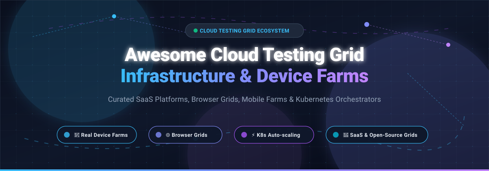

  

# 🌐 Awesome Cloud Testing Grid Infrastructure

> **A community-curated collection of elite SaaS platforms, cloud device farms, cross-browser grids, and open-source infrastructure projects for scalable automated and manual test execution.**

  
  
  
  
  
  

---

This repository tracks notable **SaaS platforms** and **open-source projects** for **Cloud Testing Grid Infrastructure** 🚀. These solutions provide the underlying compute, device, and browser infrastructure for running automated and manual tests at scale—covering real mobile device farms 📱, distributed browser grids 🌐, virtual machines 💻, and containerized orchestration ⚡ that QA engineers, platform teams, and SDETs rely on for continuous cross-browser and mobile compatibility testing.

---

## 📑 Table of Contents
- [📊 Sector Overview & Market Dynamics](#-sector-overview--market-dynamics)
- [☁️ SaaS & Hosted Platforms](#️-saas--hosted-platforms)
- [🛠️ Open-Source Projects](#️-open-source-projects)
- [🏗️ Architecture & Framework Combinations](#️-architecture--framework-combinations)
- [🤝 How to Contribute](#-how-to-contribute)
- [💖 Support](#-support)
- [⭐ Star History](#-star-history)
- [⚖️ Disclaimer](#️-disclaimer)

---

## 📊 Sector Overview & Market Dynamics

The global cloud testing market is estimated at approximately **$12.5 billion to $14.0 billion** 📈, projected to grow at a compound annual growth rate (CAGR) of **11% to 13%** to surpass **$35 billion to $45 billion** over the next decade. The sector remains **moderately fragmented** 🧩: specialized testing platforms (BrowserStack, Sauce Labs, LambdaTest) dominate high-concurrency cross-browser and real-device testing, hyperscalers (Microsoft Azure, AWS, Google Cloud) provide core compute, dev/test labs, and mobile device pools, while an active open-source ecosystem (Selenium, Playwright, Selenoid, STF, KEDA) enables organizations to avoid vendor lock-in by operating cost-efficient, self-hosted grids on Kubernetes or bare-metal infrastructure 💡.

---

## ☁️ SaaS & Hosted Platforms

Platforms are sorted in descending order by parent company market capitalization / valuation 🏢.

| Product | Company Size (Valuation / Market Cap) | Description | Pricing (Starting) | Free Tier / Trial Limits |
|:---|:---|:---|:---|:---|
| **[Azure DevTest Labs](https://azure.microsoft.com/en-us/pricing/details/devtest-lab/)** | ~$3.8T Market Cap (Microsoft) | Infrastructure provisioning service for dev/test environments. Creates VMs from reusable ARM templates with auto-shutdown and cost management policies. | Free management service; pay-as-you-go for VMs, storage, networking (e.g., B1s VM from ~$0.0104/hr or ~$7.59/mo). | Free service layer; uses Azure Free Account with 30-day $200 credit + 12 months access to 55+ services (including B1s VM). |
| **[Google Firebase Test Lab](https://firebase.google.com/docs/test-lab)** | ~$3.5T Market Cap (Alphabet) | Cloud testing infrastructure for Android and iOS mobile applications across virtual and physical devices, tightly integrated with Google Cloud and CI/CD pipelines. | Spark plan is free; Blaze pay-as-you-go: $5.00/hour per physical device, $1.00/hour per virtual device. | Spark (Free forever): 10 virtual device runs/day + 5 physical device runs/day. Blaze tier includes 60 virtual min/day + 30 physical min/day free. |
| **[AWS Device Farm](https://aws.amazon.com/device-farm/)** | ~$2.9T Market Cap (Amazon) | Managed real-device cloud service for iOS, Android, and web apps. Supports Appium, Espresso, XCTest, and interactive browser/device sessions. | Pay-as-you-go: $0.17/device-minute; Unlimited device slot: $250/month per slot (for automated tests or remote access). | One-time free trial: 1,000 free device minutes (standard promotional tier). |
| **[Oracle Cloud Infrastructure (OCI)](https://www.oracle.com/cloud/)** | ~$370B Market Cap (Oracle) | Enterprise public cloud infrastructure supporting custom dev/test environments and self-hosted Selenium/Playwright grid deployments. | Compute VMs from $0.01/hour (AMD) or $0.015/OCPU-hour (Ampere Arm); pay-as-you-go beyond Always Free limits. | Always Free: 2 AMD compute VMs (1/8 OCPU, 1 GB RAM each) + up to 4 Arm Ampere cores with 24 GB RAM + 200 GB block storage; 30-day $300 trial credit. |
| **[IBM Cloud](https://www.ibm.com/cloud)** | ~$230B Market Cap (IBM) | Enterprise cloud computing platform offering virtual servers, Kubernetes clusters, and OpenShift environments for enterprise test execution. | Compute VMs from ~$0.038/hour (~$27.74/month for 1 vCPU, 2 GB RAM); pay-as-you-go usage. | 40+ Always Free Lite plans (e.g., Cloud Foundry runtimes, object storage); 30-day $200 free credit upon signup. |
| **[Equinix Metal](https://metal.equinix.com/)** | ~$104B Market Cap (Equinix) | Automated bare-metal server infrastructure for high-throughput, low-latency, and dedicated hardware-isolated test grid execution. | On-demand bare-metal instances from ~$0.50/hour to ~$3.50/hour depending on server configuration and region. | Sales-arranged evaluation POC; no permanent free tier. |
| **[DigitalOcean](https://www.digitalocean.com/)** | ~$9.5B Market Cap (DigitalOcean) | Developer-friendly cloud platform providing Droplets (VMs), Managed Kubernetes (DOKS), and block storage for self-hosted test grids. | Droplets starting at $4.00/month (512 MB RAM / 1 vCPU / 10 GB SSD / 500 GB transfer); billed per hour with monthly cap. | 60-day $200 trial credit for new accounts; no permanent free compute tier. |
| **[BrowserStack](https://www.browserstack.com/)** | ~$4.0B Valuation (Private) | Cloud testing grid providing access to 3,000+ desktop browsers and 30,000+ real Android and iOS mobile devices. | Automate Desktop: $99/month (1 parallel session, billed annually); Desktop & Mobile: $175/month (billed annually); Live Manual: $29/month. | Free trial: 30 minutes of Live manual testing (up to 1 min/session), 100 minutes of Automate execution; Percy offers 5,000 free screenshots/month. |
| **[Sauce Labs](https://saucelabs.com/)** | ~$400M Valuation (Private) | Cloud testing platform with Virtual Device Cloud (emulators/simulators) and Real Device Cloud with unlimited automated testing minutes on paid plans. | Live Testing: $39/month (1 parallel, billed annually); Virtual Device Cloud: $149/month (billed annually); Real Device Cloud: $199/month (billed annually). | 28-day free trial: 60 minutes of live and automated testing across real devices and emulators, with 3 parallel VMs and 50 AI queries. |
| **[LambdaTest (TestMu AI)](https://www.lambdatest.com/)** | ~$400M Valuation (Private) | AI-powered test execution cloud providing cross-browser and real-device testing across 10,000+ combinations (rebranded to TestMu AI). | Live Testing: $15/month (billed annually); Desktop Automation: $79/month per parallel (billed annually); Real Device Automation: $199/month per parallel. | Free tier (forever): 100 lifetime automation minutes, 2 parallel sessions, 60 minutes/month of responsive tests, and 10 live tests/month (up to 2 min/session). |

---

## 🛠️ Open-Source Projects

Open-source test execution frameworks, browser grids, container runners, and device farm platforms sorted in descending order by GitHub_Stars ⭐.

| Project | GitHub_Stars | Stars_Badge | Description |
|:---|:---:|:---:|:---|
| **[Playwright](https://github.com/microsoft/playwright)** | 99k+ |  | Modern end-to-end testing library across Chromium, Firefox, and WebKit with native Docker container execution, parallel workers, and tracing capabilities. |
| **[Selenium](https://github.com/SeleniumHQ/selenium)** | 34k+ |  | Industry-standard browser automation framework featuring Selenium Grid 4 for distributed WebDriver routing, GraphQL node inspection, and Docker integration. |
| **[Appium](https://github.com/appium/appium)** | 22k+ |  | Cross-platform test automation tool for native, hybrid, and mobile web apps on Android and iOS devices, powering self-hosted mobile device farms. |
| **[OpenSTF](https://github.com/openstf/stf)** | 13k+ |  | Smartphone Test Farm: web-based control plane to manage, debug, and automate fleets of physical Android devices directly from your browser. |
| **[SeleniumBase](https://github.com/seleniumbase/SeleniumBase)** | 13k+ |  | Python framework for web automation and end-to-end testing with built-in grid routing, UC mode, visual testing, and headless execution. |
| **[KEDA](https://github.com/kedacore/keda)** | 10k+ |  | Kubernetes Event-driven Autoscaling: dynamic auto-scaler that scales containerized browser pods to zero based on queue depth in Selenium Grid or messaging queues. |
| **[Testcontainers](https://github.com/testcontainers/testcontainers-java)** | 8.7k+ |  | Library supporting JUnit tests with lightweight, throwaway instances of Docker containers, including headless Chrome/Firefox browser containers for ephemeral grid testing. |
| **[docker-selenium](https://github.com/SeleniumHQ/docker-selenium)** | 8.6k+ |  | Official Docker images for Selenium Grid 4 with Chrome, Firefox, and Edge nodes for containerized self-hosted test infrastructure. |
| **[DeviceFarmer STF](https://github.com/DeviceFarmer/stf)** | 4.6k+ |  | Actively maintained community fork of Smartphone Test Farm (STF) supporting contemporary Android releases, ADB remote control, and device pooling. |
| **[Selenoid](https://github.com/aerokube/selenoid)** | 2.6k+ |  | Lightweight Go implementation of Selenium hub that starts each browser session inside an isolated, disposable Docker container. |
| **[Zalenium](https://github.com/zalando/zalenium)** | 2.3k+ |  | Flexible, disposable Selenium Grid extension running in Docker containers with video recording and live preview capabilities. |
| **[Appium Test Distribution (ATD)](https://github.com/AppiumTestDistribution/AppiumTestDistribution)** | 1.0k+ |  | Open-source test runner that distributes Appium tests in parallel across connected physical Android and iOS devices and emulators. |
| **[Moon by Aerokube](https://github.com/aerokube/moon)** | 280+ |  | Kubernetes-native browser automation platform supporting Selenium, Playwright, Puppeteer, and Cypress with dynamic pod scheduling. |
| **[Callisto](https://github.com/wrike/callisto)** | 110+ |  | Kubernetes-native Selenium Grid proxy designed for scalable, isolated browser session provisioning in enterprise K8s clusters. |
| **[Selenoid4K8s](https://github.com/alcounit/selenoid4k8s)** | 8+ |  | Kubernetes orchestrator integration for Selenoid enabling on-demand browser pod provisioning per test session. |
| **[WebSummoner](https://github.com/WebSummoner/websummoner)** | 0+ |  | Apache-2.0 Go-based Selenoid-compatible daemon that runs browser sessions in ephemeral Docker containers per test request. |

---

## 🏗️ Architecture & Framework Combinations

Building an enterprise-ready self-hosted test execution cloud can be accomplished by composing best-of-breed open-source tools:

* 🔀 **Hub & Routing Layer**: Use **Selenium Grid 4** or **Callisto** to handle routing across multi-language client bindings.
* 📦 **Ephemeral Container Execution**: Pair **Selenoid** or **docker-selenium** with **Moon** on Kubernetes for zero-leak session isolation.
* ⚡ **Dynamic Autoscaling**: Implement **KEDA** on Kubernetes to scale browser node pods based on WebDriver queue metrics down to zero during idle hours.
* 📱 **Physical Device Farm Control**: Connect physical test racks using **DeviceFarmer STF** or **OpenSTF** combined with **Appium Test Distribution (ATD)** for parallel mobile regression suites.

---

## 🤝 How to Contribute

Contributions are always welcome! 🌟

1. 🍴 Fork the repository.
2. 📝 Add or update entries in `README.md` following the tabular format.
3. 🔍 Ensure:
   - For SaaS products: exact company size / valuation, specific starting pricing, and exact free tier/trial limits.
   - For open-source tools: GitHub repo link, Stars_Badge linking to `/stargazers`, and accurate description.
4. 🚀 Open a pull request with a descriptive title and rationale.

---

## 💖 Support

Thank you for exploring and using this list! If you find this resource helpful, please consider:
- ⭐ **Starring** the repository to help others discover it
- 🍴 **Forking** and contributing your favorite tools and insights
- 📢 **Sharing** with your QA, DevOps, and Platform engineering peers
- ☕ **Buying a coffee** to support ongoing maintenance and curation via the [GitHub Sponsors Dashboard](https://github.com/sponsors/ishandutta2007)

---

## ⭐ Star History

---

## ⚖️ Disclaimer

- This list is a community-curated collection for educational and informational purposes.
- Cloud testing grids execute arbitrary web and mobile automation scripts; always implement strict network policies, ephemeral sandbox containers, and token rotation to prevent security vulnerabilities.
- Pricing, trial periods, and corporate valuations fluctuate over time; verify current terms with respective service providers.

---

  Maintained with ❤️ for QA Engineers, SDETs, DevOps Architects, and Platform Teams.

